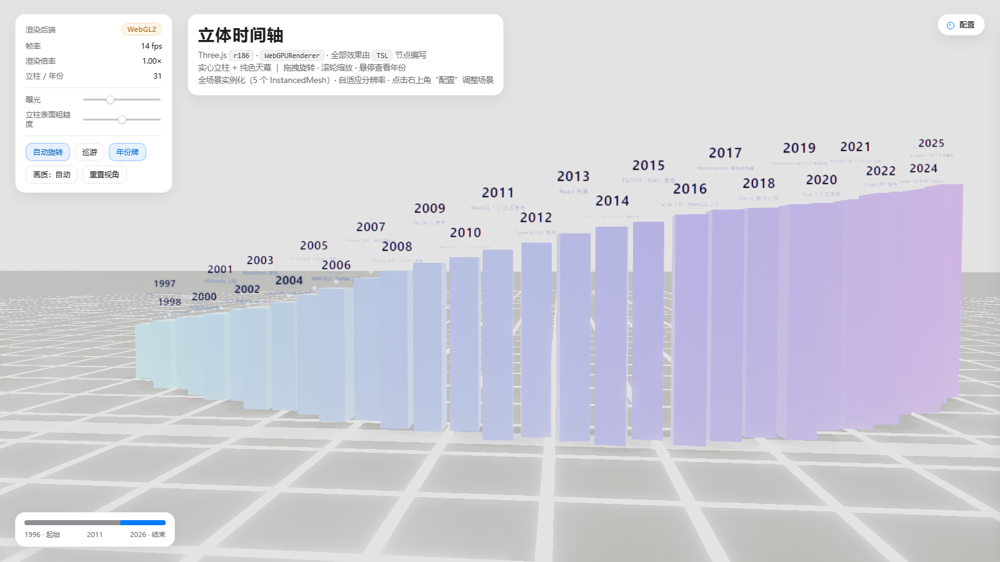

# 3D Timeline

[简体中文](./README.md) | [English](./README.en.md)

A configurable 3D timeline built with **Three.js r186 + TSL**. Each year becomes a frosted-glass pillar, with both ends fading into purple fog.

The year range, title, and color band are configurable. A Web development history dataset is included as a demo. WebGPU is used when available, with automatic fallback to WebGL2.



## Features

- **Configurable years**: edit one config file or use URL parameters.
- **Replaceable data**: per-year labels and intensity live in `src/data.js`.
- **TSL effects**: aurora sky, frosted glass, Fresnel rim light, bloom, chromatic aberration, vignette, and grain.
- **Instanced rendering**: pillars, shells, orbs, ground pools, contact shadows, and labels use `InstancedMesh`.
- **Adaptive quality**: Auto / Ultra / Eco modes, with desktop and LAN support.

## Quick Start

Double-click:

```bat
start.bat
```

Or start a static server manually:

```bash
python -m http.server 8123
# Open http://localhost:8123/index.html
```

> Do not open `index.html` directly. ES modules and import maps are blocked under `file://` by CORS.

### LAN / Mobile

```bat
start.bat          :: http://<LAN-IP>:8123/index.html, WebGL2-compatible
start-https.bat    :: https://<LAN-IP>:8443/index.html, self-signed HTTPS, WebGPU available
```

Allow the HTTPS port through Windows Firewall on first use:

```bat
netsh advfirewall firewall add rule name="timeline-8443-lan" dir=in action=allow protocol=TCP localport=8443 remoteip=LocalSubnet
```

## Configuration

The defaults live in `DEFAULT_CONFIG` inside `src/config.js`:

```js
const DEFAULT_CONFIG = {
  title: '立体时间轴',
  startYear: 1996,
  endYear: 2026,
  hueStart: 190,
  hueEnd: 325
};
```

You can also override them from the URL:

| Parameter | Example | Purpose |
| --- | --- | --- |
| `start` | `?start=2000` | First year |
| `end` | `?end=2024` | Last year |
| `title` | `?title=My%20Timeline` | Page title |
| `hueStart` | `?hueStart=180` | Start hue |
| `hueEnd` | `?hueEnd=340` | End hue |

Example:

```text
http://localhost:8123/index.html?start=2000&end=2024&title=Product%20Evolution
```

### Replace Events

Edit `EVENT_DATA` in `src/data.js`:

```js
export const EVENT_DATA = {
  2007: { tag: 'iPhone launch', heat: 0.74 },
  2013: { tag: 'React is open-sourced', heat: 1.06 },
  2022: { tag: 'ChatGPT launch', heat: 1.38 }
};
```

- `tag`: text shown on hover.
- `heat`: pillar height, orb size, and brightness.
- Years without an entry receive a smooth default height and an empty label.

## Interaction

| Action | Result |
| --- | --- |
| Drag / wheel | Orbit and zoom |
| Hover a pillar | Show year, label, height, and index |
| Click a pillar | Smooth camera focus |
| Auto rotate | Subtle camera breathing; disabled after manual drag |
| Cruise | Fly along the timeline |
| Fog / exposure / glass roughness | Live tuning |
| Year labels | Toggle labels |

Console access:

```js
window.timeline.{scene,camera,controls,pillars,state,renderer}
```

Add `?bench=1` to show GPU time, draw calls, triangle count, and other performance readings.

## Structure

```text
index.html      Page shell and glass HUD
src/config.js   Title, year range, and color configuration
src/data.js     Event data, year generation, and layout math
src/main.js     Scene setup, camera modes, picking, and HUD
src/pillars.js  Glass pillars, shells, orbs, ground pools, and label atlas
src/sky.js      Aurora sky, backdrop, and environment map
src/dust.js     Dust particles
src/postfx.js   Bloom, chromatic aberration, vignette, grain, and color split
serve-https.py  Local LAN HTTPS server
```

## Implementation Notes

### Frosted Glass

`MeshPhysicalNodeMaterial` uses `transmission` for refraction and TSL overrides for:

- `roughnessNode`: fractal-noise frosted grain.
- `thicknessNode`: thicker at the bottom and thinner at the top.
- `emissiveNode`: Fresnel rim, top highlight band, and inner gradient.

Each pillar also has an enlarged `BackSide` light shell so its silhouette stays readable through fog and bloom.

### Instancing

TSL bakes per-object constants into WGSL. Building a separate material for each pillar would create many shader programs.

All pillars share unit geometry instead:

- color via `instanceColor`
- phase via `instanceIndex`
- size and orientation via `instanceMatrix`

Year labels are packed into a dynamic atlas, with UVs computed from `instanceIndex`.

### Performance

- Screen-space overlap avoidance for year labels.
- Downscaled bloom chain.
- Rendering stops when the tab is hidden.
- Adaptive quality based on real GPU/CPU cost.
- Reused temporary vectors and matrices in the main loop.

Headless browsers and remote desktops may cap rendering at 30Hz. Use GPU time and draw calls from `?bench=1` instead of frame rate alone.

## Browser Support

| Environment | Renderer |
| --- | --- |
| Local `localhost` | WebGPU |
| HTTPS over LAN | WebGPU |
| HTTP over LAN | WebGL2 |
| Browsers without WebGPU | WebGL2 |

## License

[MIT](./LICENSE)
